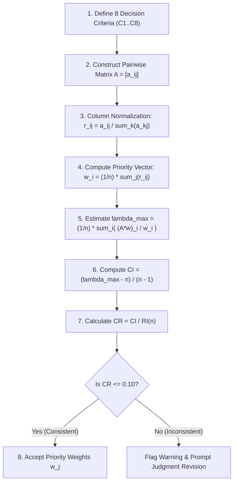
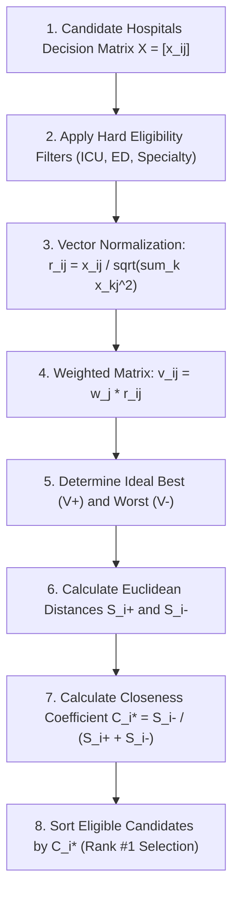

# Multi-Criteria Decision-Making (MCDM) Algorithm Specification

## Hybrid AHP + TOPSIS Engine for Emergency Ambulance Routing

### 1. Mathematical Rationale
Selecting an emergency medical destination cannot rely solely on physical proximity. A nearby clinic lacking critical cardiology or ICU equipment is fatal for a STEMI cardiac arrest patient. Conversely, sending a minor accident patient to a tertiary trauma center 40 km away exhausts high-level regional resources.

The system deploys a **Hybrid AHP-TOPSIS model**:
- **Analytic Hierarchy Process (AHP):** Quantifies the subjective relative importance of competing criteria and ensures judgment consistency ($CR \le 0.10$).
- **Patient-Specific Dynamic Multipliers:** Dynamically adjusts criteria weights based on clinical triage (Cardiac, Trauma, Stroke, Respiratory).
- **TOPSIS:** Ranks candidate hospitals based on their geometric distance in multi-dimensional space to the Positive Ideal Solution ($V^+$) and Negative Ideal Solution ($V^-$).

---

### 2. AHP Algorithmic Flow

#### AHP Mathematical Formulations:
1. **Pairwise Comparison Matrix ($A$):**
   $$A = \begin{bmatrix} 1 & a_{12} & \cdots & a_{1n} \\ a_{21} & 1 & \cdots & a_{2n} \\ \vdots & \vdots & \ddots & \vdots \\ a_{n1} & a_{n2} & \cdots & 1 \end{bmatrix}, \quad a_{ji} = \frac{1}{a_{ij}}$$

2. **Column Normalization:**
   $$r_{ij} = \frac{a_{ij}}{\sum_{k=1}^n a_{kj}}$$

3. **Priority Vector (Weights $w_i$):**
   $$w_i = \frac{1}{n} \sum_{j=1}^n r_{ij}$$

4. **Consistency Verification:**
   $$\lambda_{\max} = \frac{1}{n} \sum_{i=1}^n \frac{(A \cdot w)_i}{w_i}$$
   $$CI = \frac{\lambda_{\max} - n}{n - 1}, \qquad CR = \frac{CI}{RI}$$

---

### 3. TOPSIS Algorithmic Flow

#### TOPSIS Mathematical Formulations:
1. **Vector Normalization:**
   $$r_{ij} = \frac{x_{ij}}{\sqrt{\sum_{k=1}^m x_{kj}^2}}$$

2. **Weighted Normalized Value:**
   $$v_{ij} = w_j \cdot r_{ij}, \quad \text{where } \sum_{j=1}^n w_j = 1$$

3. **Positive Ideal Solution ($V^+$) and Negative Ideal Solution ($V^-$):**
   $$v_j^+ = \begin{cases} \max_i v_{ij} & \text{if } j \in \text{Benefit} \\ \min_i v_{ij} & \text{if } j \in \text{Cost} \end{cases}, \qquad v_j^- = \begin{cases} \min_i v_{ij} & \text{if } j \in \text{Benefit} \\ \max_i v_{ij} & \text{if } j \in \text{Cost} \end{cases}$$

4. **Separation Measures (Euclidean Distances):**
   $$S_i^+ = \sqrt{\sum_{j=1}^n (v_{ij} - v_j^+)^2}, \qquad S_i^- = \sqrt{\sum_{j=1}^n (v_{ij} - v_j^-)^2}$$

5. **Relative Closeness Coefficient ($C_i^*$):**
   $$C_i^* = \frac{S_i^-}{S_i^+ + S_i^-}, \quad 0 \le C_i^* \le 1$$

---

### 4. Classification of Decision Criteria

| Criterion | Code | Type | Description | Optimization |
| :--- | :--- | :--- | :--- | :--- |
| **Travel Time** | C1 | **COST** | Traffic-adjusted ambulance transit duration (minutes) | Minimization |
| **Physical Distance** | C2 | **COST** | Road network driving distance (kilometers) | Minimization |
| **Emergency Dept** | C3 | **BENEFIT** | Resuscitation bays & acute triage readiness | Maximization |
| **Specialty Match** | C4 | **BENEFIT** | Direct clinical match to patient diagnosis | Maximization |
| **ICU Availability** | C5 | **BENEFIT** | Available intensive care beds & nursing staff | Maximization |
| **Available Capacity** | C6 | **BENEFIT** | Hospital headroom (100 - occupancy percentage) | Maximization |
| **Equipment** | C7 | **BENEFIT** | Ventilators, CT scanners, blood bank reserves | Maximization |
| **Hospital Rating** | C8 | **BENEFIT** | Clinical accreditation & patient outcome score | Maximization |

---

### 5. Patient-Specific Clinical Weight Adjustments

For acute conditions, the algorithm dynamically scales criteria priorities:

- **Cardiac Emergencies:**
  - $w_{\text{Cardiology}} \times 1.75$, $w_{\text{ICU}} \times 1.50$, $w_{\text{TravelTime}} \times 1.25$
  - Dampens non-essential criteria (Distance, General Capacity, Rating).
- **Polytrauma / Accidents:**
  - $w_{\text{TraumaCenter}} \times 1.70$, $w_{\text{EmergencyDept}} \times 1.40$, $w_{\text{BloodBank}} \times 1.25$
- **Acute Ischemic Stroke:**
  - $w_{\text{Neurology}} \times 1.80$, $w_{\text{TravelTime}} \times 1.40$ (preserves the 4.5-hour thrombolysis Golden Window).
- **Severe Respiratory Distress:**
  - $w_{\text{ICU}} \times 1.75$, $w_{\text{Ventilator}} \times 1.70$.

All weights are re-normalized using $\bar{w}_j = \frac{w_j'}{\sum_{k} w_k'}$ so the total sum always equals $1.000$.

---

### 6. Clinical Hard Constraints (Eligibility Pruning)

Before running TOPSIS, facilities that fail mandatory clinical intake conditions are partitioned into the **Ineligible Set**:
1. **Emergency Department Status:** Must be active and not under total diversion.
2. **ICU Requirement:** If patient is Critical or explicitly requires ICU, $ICU_{\text{available}} > 0$.
3. **Clinical Specialty Match:** If condition is Cardiac, facility must have active cardiology/cath lab; if critical trauma, accredited trauma bay required.
4. **Ventilator Availability:** Required for respiratory failure emergencies.

Ineligible hospitals are displayed in the comparison table with explicit exclusion rationale (e.g. *"Zero available ICU beds"* or *"Emergency Department closed"*), ensuring clinical safety and transparency.
