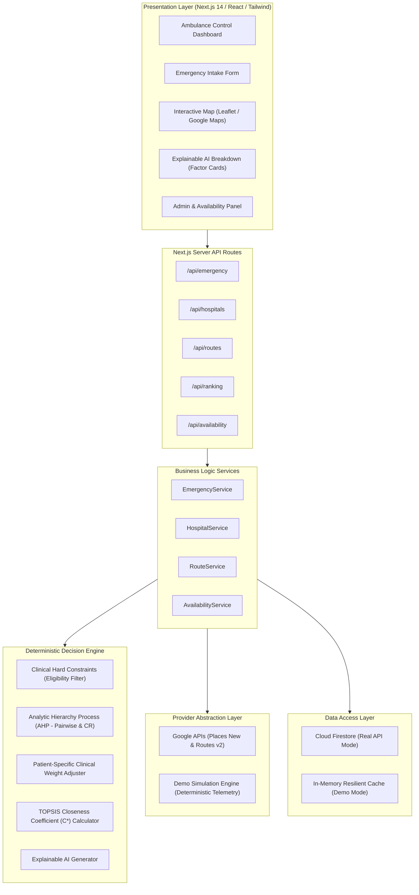
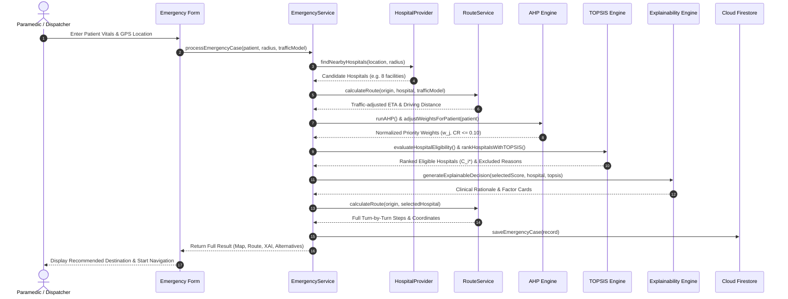

# System Architecture & Technical Specification

## AI-Based Ambulance Routing and Hospital Selection System

### 1. System Overview
The system employs a layered, service-oriented architecture designed for mission-critical emergency medical dispatch and hospital triage. It couples real-time GIS mapping and traffic-aware routing with deterministic Multi-Criteria Decision-Making (MCDM) algorithms (AHP and TOPSIS) to select the optimal acute medical facility for time-critical emergency patients.

---

### 2. High-Level System Architecture Diagram

---

### 3. Core Emergency Decision Flow

---

### 4. Layered Architectural Decomposition

| Layer | Directory / Modules | Primary Responsibility |
| :--- | :--- | :--- |
| **1. Presentation Layer** | `/app`, `/components` | Responsive dashboard, multi-step intake, interactive GIS maps, XAI factor cards, printable reports. |
| **2. API Layer** | `/app/api/*` | Validated server endpoints for emergency intake, routing computation, and hospital queries. |
| **3. Business Logic Layer** | `/services/*` | Domain workflows orchestrating triage intake, provider switching, and telemetry aggregation. |
| **4. Decision Engine** | `/lib/ahp`, `/lib/topsis`, `/lib/decision-engine` | Pure mathematical models for pairwise AHP consistency, patient weights, and TOPSIS vector ranking. |
| **5. External Services Layer** | `/lib/google-maps`, `/services/providers` | Google Places API (New) & Routes API v2 client adapters with graceful demo fallbacks. |
| **6. Data Access Layer** | `/lib/firebase` | Cloud Firestore persistence with role-based security rules and offline memory cache. |
| **7. Configuration Layer** | `/lib/simulation`, `/types` | Strongly-typed interfaces, default criteria calibrations, and preset clinical scenarios. |

---

### 5. Resilient Provider Fallback Strategy

The application guarantees uninterrupted uptime through the **Provider Pattern**:

1. **Hospital Discovery:**
   - Primary: `GoogleHospitalProvider` calling `https://places.googleapis.com/v1/places:searchNearby`.
   - Fallback: `DemoHospitalProvider` using 8 curated test hospitals with realistic coordinates, capacity, and bed counts.
2. **Ambulance Routing:**
   - Primary: `GoogleRoutingProvider` calling `https://routes.googleapis.com/directions/v2:computeRoutes` (`TRAFFIC_AWARE_OPTIMAL`).
   - Fallback: `DemoRoutingProvider` using Haversine driving multipliers, realistic road grid interpolation, and turn-by-turn guidance.
3. **Database Storage:**
   - Primary: Cloud Firestore `emergencyCases` collection.
   - Fallback: High-performance in-memory cache retaining recent dispatches and reports.
