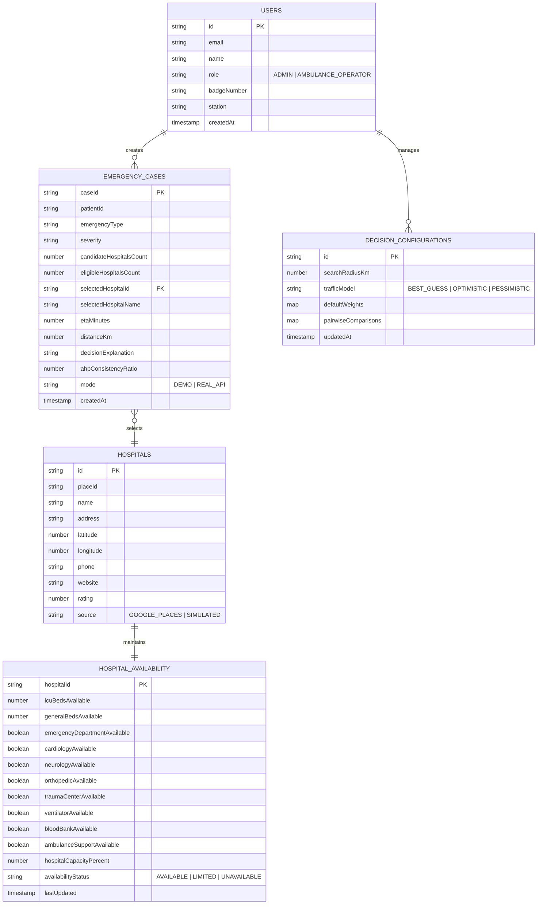

# Cloud Firestore Database Design & Schema Models

## AI Ambulance Routing & Hospital Selection System

### 1. Database Architecture
The database layer uses **Google Cloud Firestore**, a NoSQL document database providing low-latency real-time synchronization and ACID document transactions. In offline or demonstration environments where Firebase credentials are absent, an in-memory resilient data store mirrors these collections.

---

### 2. Entity-Relationship & Collections Diagram



---

### 3. Collection Specifications

#### Collection: `emergencyCases`
Stores immutable audit records of all dispatched emergencies and algorithmic decisions.
```json
{
  "caseId": "CASE-2026-4821",
  "patientId": "PT-CARD-801",
  "createdAt": "2026-09-30T09:15:00.000Z",
  "patientData": {
    "age": 65,
    "gender": "MALE",
    "emergencyType": "CARDIAC",
    "severity": "CRITICAL",
    "medicalCondition": "Acute STEMI",
    "requiresIcu": true
  },
  "location": {
    "latitude": 12.9716,
    "longitude": 77.5946,
    "address": "MG Road Metro Junction"
  },
  "candidateHospitalsCount": 8,
  "eligibleHospitalsCount": 4,
  "excludedHospitalsCount": 4,
  "selectedHospitalId": "hosp-001",
  "selectedHospitalName": "Metro Central Trauma & Heart Institute",
  "etaMinutes": 8,
  "distanceKm": 3.2,
  "decisionExplanation": "Selected based on rank #1 TOPSIS score (0.842), 6 ICU beds, and cardiology cath lab readiness.",
  "ahpConsistencyRatio": 0.042,
  "mode": "DEMO",
  "status": "ACTIVE"
}
```

#### Collection: `hospitalAvailability`
Maintains operational telemetry and diversion flags for participating facilities.
```json
{
  "hospitalId": "hosp-001",
  "icuBedsAvailable": 6,
  "generalBedsAvailable": 34,
  "emergencyDepartmentAvailable": true,
  "cardiologyAvailable": true,
  "neurologyAvailable": true,
  "orthopedicAvailable": true,
  "traumaCenterAvailable": true,
  "ventilatorAvailable": true,
  "bloodBankAvailable": true,
  "ambulanceSupportAvailable": true,
  "hospitalCapacityPercent": 72,
  "availabilityStatus": "AVAILABLE",
  "lastUpdated": "2026-09-30T09:00:00.000Z"
}
```

---

### 4. Firestore Security Rules
Security rules (`firestore.rules`) enforce role-based access control (RBAC):
- **AMBULANCE_OPERATOR:** Granted read access to hospital telemetry, read/write to `emergencyCases`, read on system configurations.
- **ADMIN:** Full read and write authority over `hospitals`, `hospitalAvailability`, `decisionConfigurations`, and case records.
- **Unauthenticated:** Read and write operations strictly rejected.
